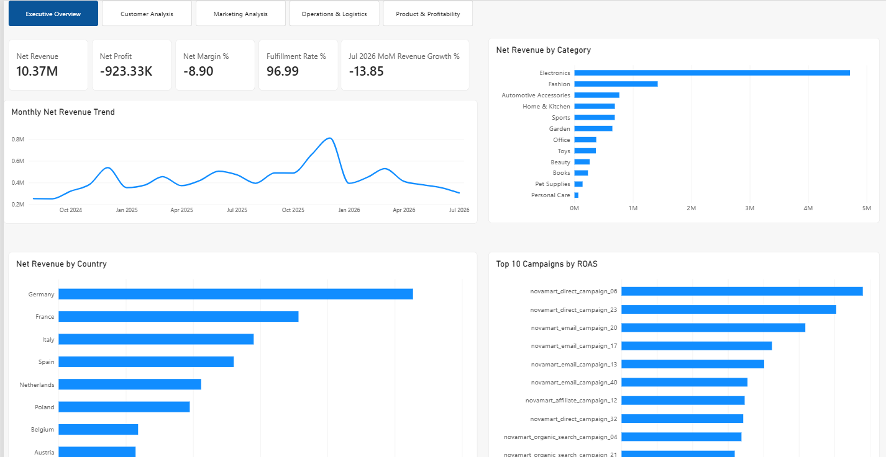

# NovaMart Business Intelligence Platform

**End-to-end synthetic e-commerce BI portfolio** — Python data generation and ETL, SQL Server, KPI validation, and a five-page Power BI report.

> **Synthetic data:** This project is a simulated business case; financial results and recommendations are descriptive, not real-company performance.



**Dashboard pages:** [Executive Overview](dashboard/dashboard_preview/01_executive_overview.png) · [Customer Analysis](dashboard/dashboard_preview/02_customer_analysis.png) · [Marketing Analysis](dashboard/dashboard_preview/03_marketing_analysis.png) · [Operations & Logistics](dashboard/dashboard_preview/04_operations_logistics.png) · [Product & Profitability](dashboard/dashboard_preview/05_product_profitability.png)

**Power BI report:** [NovaMart_BI_Final_Portfolio.pbix](dashboard/NovaMart_BI_Final_Portfolio.pbix)

## Project Overview

The project demonstrates practical work with:

- Python ETL
- data-quality validation and quarantine
- Microsoft SQL Server
- analytical SQL views
- KPI reconciliation
- Power BI
- DAX measures
- dashboard design and business analysis

The solution follows this pipeline:

```text
Synthetic Data Generation
        ↓
Raw Data
        ↓
Python ETL
        ↓
Data Quality Validation
        ↓
Clean / Quarantine Layers
        ↓
SQL Server
        ↓
Analytical SQL Views
        ↓
Power BI
        ↓
DAX Measures
        ↓
Business Dashboards
```

## Tech Stack

- **ETL / Data Processing:** Python, Pandas, PyODBC
- **Database:** Microsoft SQL Server, SQL Server Management Studio
- **BI & Analytics:** Microsoft Power BI Desktop, DAX
- **Version Control:** Git, GitHub

## Governing Purchase Rule

For customer, sales, marketing-attribution, and financial KPIs, an **eligible completed purchase** must have status `paid`, `fulfilled`, `shipped`, or `delivered` and at least one successful payment. `placed` and `cancelled` orders are excluded.

## Business Questions

NovaMart was designed to answer questions such as:

- How much Net Revenue is the business generating?
- How much revenue is lost through refunds?
- Which countries and categories generate the most value?
- Which customer segments have the highest lifetime value?
- How effective are marketing campaigns and promotions?
- Which carriers perform best on delivery speed and reliability?
- Which categories have the highest return rates?
- Which products and categories generate the most Gross Profit?
- How are operating costs affecting profitability?

## Analytical Layer

The SQL analytical layer contains **18 canonical analytical views**, plus `vw_marketing_attribution` as a helper/summary view used for attribution inspection. The Power BI model currently imports 19 `vw_*` objects in total.

### Revenue & Profitability
- `vw_revenue_performance`
- `vw_revenue_growth`
- `vw_profitability`
- `vw_cost_performance`

### Product & Category
- `vw_product_sales`
- `vw_product_profitability`
- `vw_category_performance`

### Geography
- `vw_country_performance`

### Customer
- `vw_customer_value`
- `vw_customer_rfm`
- `vw_customer_retention`

### Marketing
- `vw_marketing_performance`
- `vw_funnel_performance`
- `vw_promotion_performance`

### Attribution helper
- `vw_marketing_attribution`

### Operations
- `vw_fulfillment_performance`
- `vw_delivery_performance`
- `vw_carrier_performance`
- `vw_return_performance`

## Data Quality

The ETL pipeline follows:

```text
Raw → Clean → Quarantine
```

Invalid records are not silently removed. Records that fail validation are stored in a quarantine layer so data-quality problems remain traceable.

Validation covers issues such as:

- invalid quantities
- foreign-key violations
- invalid promotions
- invalid marketing records
- shipment inconsistencies
- invalid returns
- invalid payments
- invalid refunds
- date consistency problems

The final clean/quarantine ETL produces **16,571 quarantined records** under the validated dataset. Large generated/raw/processed CSVs are excluded from Git to keep the repository lightweight.

## Revenue Reconciliation

A core requirement was ensuring that financial metrics reconcile consistently across analytical views.

| Metric | Value |
|---|---:|
| Sales Revenue | €11,261,554.82 |
| Refunds | €890,386.00 |
| Net Revenue | €10,371,168.82 |
| Gross Profit | €2,943,383.00 |
| Contribution Profit | €2,266,275.67 |
| Net Profit | -€923,327.19 |
| Net Margin | -8.90% |

> These figures are the final stability-patched dataset totals under the governing eligible-purchase rule and full cost model. The negative Net Profit is an intentional analytical outcome of the synthetic scenario, not a reconciliation error: marketing plus operating expenses exceed the remaining contribution profit.

Revenue and gross-profit totals reconcile across:

- Revenue Performance
- Product Sales
- Product Profitability
- Category Performance
- Country Performance
- Profitability

## Refund Allocation

For product-level analysis:

1. Refunds linked to returns are assigned to the related order line.
2. Refunds without a return identifier are allocated proportionally across order lines based on revenue share.
3. Rounding remainder is assigned so product-level totals reconcile exactly with overall refunds.

```text
Sales Revenue - Refunds = Net Revenue
```

## Key KPIs

### Revenue
- Sales Revenue
- Refund Amount
- Net Revenue
- Month-over-Month Revenue Growth

### Profitability
- Gross Profit
- Gross Margin
- Contribution Profit
- Net Profit
- Net Margin
- Operating Cost-to-Revenue Ratio

### Customer
- Customer Lifetime Revenue
- Customer Lifetime Profit
- Customer Segmentation
- RFM Metrics
- Retention Rate

### Marketing
- ROAS
- CTR
- CPC
- Attributed Net Revenue
- Conversion Rate
- Promotion Revenue Uplift

### Operations
- Fulfillment Rate
- Cancellation Rate
- Average Order-to-Ship Hours
- On-Time Delivery Rate
- Average Delivery Hours
- Return Rate
- Unit Return Rate (diagnostic)
- Shipping Cost

# Power BI Dashboard

The report contains **5 analytical pages**.

## 1. Executive Overview

**KPIs**
- Net Revenue
- Net Profit
- Net Margin %
- Fulfillment Rate %
- Latest MoM Revenue Growth %

**Visuals**
- Monthly Net Revenue Trend
- Net Revenue by Country
- Net Revenue by Category
- Top 10 Campaigns by ROAS

## 2. Customer Analysis

**Visuals**
- Customer Segments
- Customer Retention Trend
- Customer Lifetime Net Revenue by Segment
- Average Customer Value by Segment

Customer segments are derived from clean order counts:

```text
1 order       → one_time
2–5 orders    → occasional
6–10 orders   → frequent
11+ orders    → loyal
```

The latest incomplete retention cohort (July 2026) is excluded to avoid incorrectly displaying 0% N+1 retention when August 2026 activity is not observable.

## 3. Marketing Analysis

**Visuals**
- Conversion Rate by Channel
- Top 10 Campaigns by ROAS
- Top 10 Promotions by Revenue Uplift %
- Top 10 Campaigns by Attributed Net Revenue

Weighted conversion:

```DAX
Conversion Rate % =
DIVIDE(
    SUM(vw_funnel_performance[purchase_sessions]),
    SUM(vw_funnel_performance[total_sessions]),
    0
) * 100
```

## 4. Operations & Logistics

**KPIs**
- Fulfillment Rate %
- Cancellation Rate %
- Average Order-to-Ship Hours
- Average Shipping Cost

**Visuals**
- On-Time Delivery Rate by Carrier
- Average Delivery Hours by Carrier
- Return Rate by Carrier
- Return Rate % by Category

Current dashboard weighted **unit** return-rate diagnostic:

```DAX
Unit Return Rate % =
DIVIDE(
    SUM(vw_return_performance[returned_units]),
    SUM(vw_return_performance[sold_units]),
    0
) * 100
```

## 5. Product & Profitability

**KPIs**
- Gross Profit
- Gross Margin %
- Contribution Profit
- Net Profit

**Visuals**
- Top 10 Products by Gross Profit
- Gross Profit by Category
- Monthly Net Profit Trend
- Operating Cost-to-Revenue Ratio Trend

## DAX Measures

### Net Margin

```DAX
Net Margin Overall % =
DIVIDE(
    SUM(vw_profitability[net_profit]),
    SUM(vw_profitability[net_revenue]),
    0
) * 100
```

### Gross Margin

```DAX
Gross Margin Overall % =
DIVIDE(
    SUM(vw_profitability[gross_profit]),
    SUM(vw_profitability[net_revenue]),
    0
) * 100
```

### Operating Cost-to-Revenue Ratio

```DAX
Cost to Revenue Ratio % =
DIVIDE(
    SUM(vw_profitability[operating_costs]),
    SUM(vw_profitability[net_revenue]),
    0
) * 100
```

## Selected Insights

- Germany generates the highest Net Revenue among the modeled markets.
- Electronics is the strongest revenue-generating category.
- Loyal customers generate the highest lifetime value per customer.
- Next-month retention varies across observable cohorts; the final month is excluded because N+1 activity is not observable.
- Marketing channels have similar conversion rates while campaign ROAS varies considerably.
- Modeled promotions now show a mix of positive and negative descriptive revenue uplift versus the 28-day pre-promotion baseline; this is a scenario comparison, not a causal estimate.
- SwiftPost combines strong on-time performance with relatively low average delivery time.
- Fashion has one of the highest weighted unit-return rates in the modeled dataset.
- Despite €10.37M in Net Revenue and €2.94M in Gross Profit, high marketing and operating expenses produce a modeled Net Loss of €0.92M, illustrating why revenue growth alone does not guarantee profitability.
- Operating cost pressure changes significantly month to month.

## Repository Structure

```text
novamart-bi-platform/
├── data/
│   ├── raw/
│   ├── processed/
│   ├── quarantine/
│   └── generated/
├── src/data_generation/
├── etl/
├── sql/
│   ├── schema_sqlserver.sql
│   ├── views/
│   ├── tests/
│   └── mysql_archive/
├── docs/
├── dashboard/
│   ├── NovaMart_BI_Final_Portfolio.pbix
│   └── dashboard_preview/
├── images/
├── requirements.txt
├── .env.example
├── .gitignore
└── README.md
```

## How to Run

### 1. Create the SQL Server database

```sql
CREATE DATABASE novamart;
```

Run `sql/schema_sqlserver.sql` in SQL Server Management Studio to create the schema.

### 2. Create and activate a Python virtual environment

```bash
python -m venv .venv
```

Then install dependencies:

```bash
pip install -r requirements.txt
```

### 3. Generate synthetic data and run ETL

Synthetic data generation scripts are in `src/data_generation/`. Execute them in dependency order, beginning with the reference data, products, customers, campaigns and promotions, and then order/payment/logistics/marketing facts. Once `data/raw/` has been populated by the synthetic defect-injection step, run the ETL:

```powershell
python etl/run_etl.py
python scripts/validate_final_stability.py
```

The full example dataset is **not committed** to this repository; the included Power BI file demonstrates the validated portfolio snapshot. Regenerating randomized synthetic data may lead to different KPI totals from the displayed snapshot.

### 4. Configure and load clean data into SQL Server

Set the SQL Server instance and database with environment variables (see `.env.example`). For PowerShell, for example:

```powershell
$env:NOVAMART_SQL_SERVER="localhost\SQLEXPRESS"
$env:NOVAMART_SQL_DATABASE="novamart"
```

Then use the PyODBC loader to populate the `novamart` database:

```bash
python etl/load_to_sqlserver.py
```

### 5. Create analytical views

Execute the 19 view scripts in `sql/views/` in the dependency order listed in [SQL view instructions](sql/views/README.md). The migration at `sql/patches/final_stability_patch.sql` was used only for the previous v2 database snapshot; **do not run it against a fresh dataset**.
### 6. Validate analytical totals

Run:

```text
sql/tests/final_sql_validation.sql
```

### 7. Open Power BI

Open:

```text
dashboard/NovaMart_BI_Final_Portfolio.pbix
```

Refresh the SQL Server connection if required.

## Future Improvements

- Star-schema Power BI model
- Shared Date and Country dimensions
- Report-wide and cross-page slicers
- Incremental refresh
- Automated ETL orchestration
- Cloud deployment
- Power BI Service publishing
- Row-Level Security
- Forecasting
- Churn modeling
- Automated data-quality monitoring

## Project Purpose

This project demonstrates an end-to-end Business Intelligence workflow and practical skills in:

- SQL
- Python ETL
- data quality
- relational database design
- analytical modeling
- KPI design
- Power BI
- DAX
- dashboard design
- data reconciliation
- business analysis
