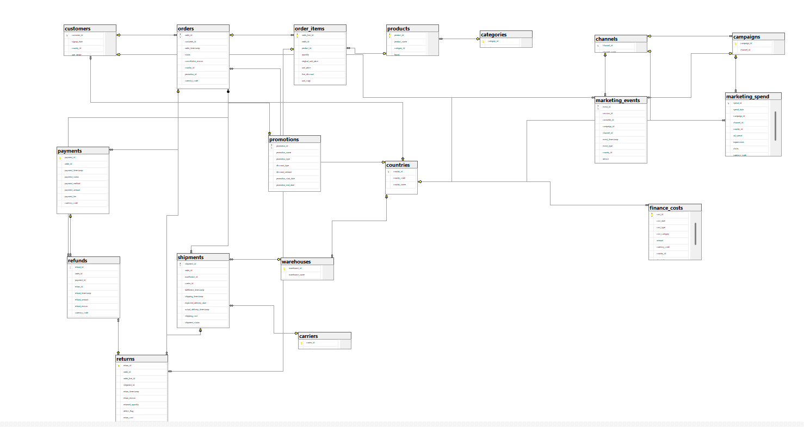

# SQL Layer — Architecture Notes

## RAW / CLEAN / QUARANTINE placement decision

Per `docs/00_project_charter.md` §9.1, the data flow is:

```text
Synthetic Source Files
        ↓
RAW layer (immutable)
        ↓
Validation
   ↙          ↘
QUARANTINE    CLEAN
```

**Decision:** RAW lives as immutable CSV files in `data/raw/` (git-tracked,
never overwritten). MySQL holds only the **CLEAN** layer (`schema.sql`) and
the **QUARANTINE** table. Duplicating all 18 source entities a second time as
untyped MySQL staging tables would double the schema for no analytical
benefit — the "raw is immutable" principle is fully satisfied by never
modifying the original CSV files, which are the actual system of record for
raw data.

This means Sprint 2's Python ETL reads directly from `data/raw/*.csv`,
applies the DQ rules from `docs/03_data_quality.md`, and writes:
- passing rows → CLEAN tables below
- failing rows → `quarantine` table (with `dq_rule_id`, `failure_reason`, and
  the original row preserved as JSON in `raw_payload`)

## Database Engine

**Primary target: SQL Server (T-SQL)**, managed via SQL Server Management
Studio (SSMS) — `schema_sqlserver.sql`. This is the actively maintained
version going forward.

**Legacy: MySQL/MariaDB** — `mysql_archive/schema_mysql_v1.sql`. Built and
fully tested first (live inserts against a real MariaDB instance — see
Sprint 1 notes in the project history). Kept for reference since the KPI
Dictionary and ETL logic were originally validated against it.

### How each was validated

| Engine | Method | Result |
|---|---|---|
| MySQL/MariaDB | Installed live MariaDB in sandbox; ran full schema; inserted valid rows; attempted 6 invalid inserts (negative quantity, negative price, bad promotion dates, clicks > impressions, orphan FK, non-EUR currency) | All 6 invalid inserts correctly rejected; valid insert succeeded |
| SQL Server (T-SQL) | No live SQL Server available in this environment (Microsoft's install servers aren't reachable here). Validated statically instead: (1) `sqlglot` parsed all 52 statements with the `tsql` dialect — 0 syntax errors; (2) cross-checked all 32 foreign keys against actual table/column definitions — 0 referential errors; (3) table count confirmed at 22/22 | 0 errors found; **not yet tested with live inserts** — recommend running the 6 invalid-insert tests yourself in SSMS before trusting it fully |

## Files

- `schema_sqlserver.sql` — **T-SQL version, use this one** (22 tables + quarantine)
- `mysql_archive/schema_mysql_v1.sql` — original MySQL version, kept for reference
- `erd.mmd` — Mermaid ER diagram (full 22-table reference, engine-agnostic)

## ER Diagram



**Scope note:** this diagram intentionally shows only the **18 core/source
entities** — the tables that hold actual business data (orders, customers,
products, payments, shipments, marketing activity, etc.). It deliberately
excludes 4 tables that are not part of the source data model:

| Excluded table | Why |
|---|---|
| `marketing_attribution` | ETL-computed output (last-touch attribution result), not a source entity |
| `customer_cohorts` | ETL-computed output (cohort/retention flag), not a source entity |
| `dim_date` | Standalone calendar helper table, no relationships to show |
| `quarantine` | Pipeline infrastructure (holds rejected rows), not part of the business data model |

This mirrors a common real-world convention: a **conceptual/source ERD**
(what this diagram shows) is kept separate from the **full technical
schema** (all 22 tables, fully documented in `schema.sql` and
`docs/04_data_dictionary.md`). All 32 foreign key relationships in the
database were verified against this diagram — the 18 shown entities and
their 27 relationships match exactly; the remaining 5 relationships belong
to the 4 excluded tables.
